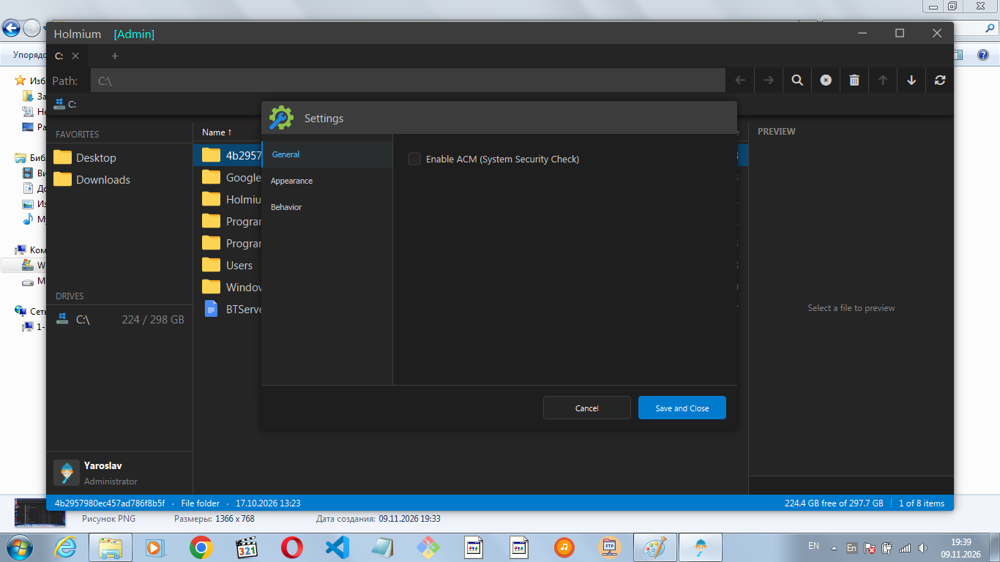
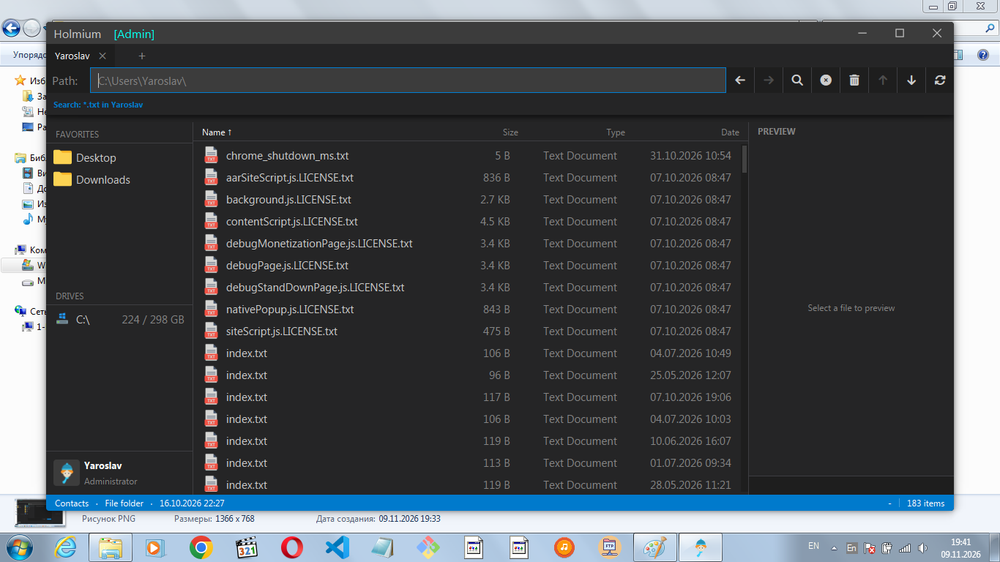
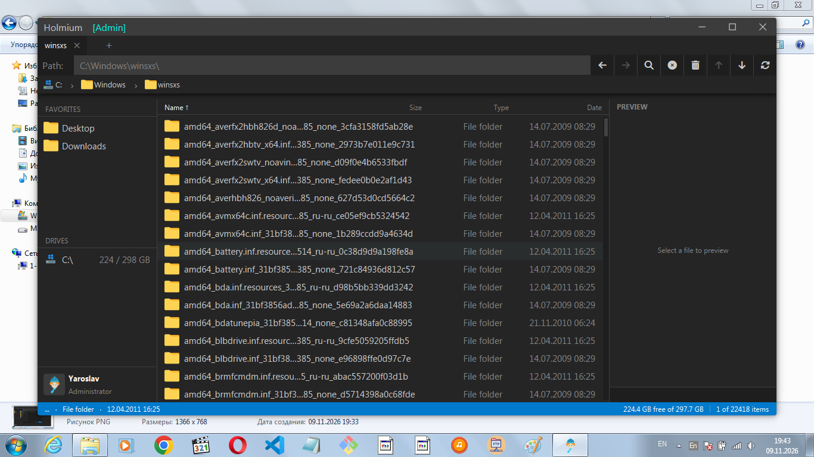

# Holmium File Explorer






**Holmium** is a fast, minimalist, and cross-platform file manager written in Python using PySide2 (Qt).

Inspired by the aesthetics of VSCode Dark+ and the functionality of Total Commander, Holmium is designed for those who lack the speed and convenience of standard Windows Explorer.

## ✨ Key Features

*   **Speed**: Instant opening of folders with tens of thousands of files (thanks to `QListView` and background threads).
*   **Tabs**: Support for multiple tabs with navigation history preserved in each.
*   **Built-in Search**: Recursive file search by mask (`r_*.py` or `r_**.txt`) without using the heavy Windows indexer.
*   **Command Palette**: Invoke system windows and commands via the command line (`holmium://settings`).
*   **Archive Handling**: Built-in packing and unpacking of ZIP archives with a progress bar.
*   **Text Editor**: Built-in editor with syntax highlighting (Python, JSON).
*   **Advanced Drag & Drop**: File dragging with a custom "ghost" and `Ctrl` support for copying.
*   **Dark Theme**: Unified interface in the VSCode style.

## 🚀 Installation and Launch

1. Clone the repository:
   ```bash
   git clone https://github.com/YaroslavIshkov/Holmium.git
   cd Holmium